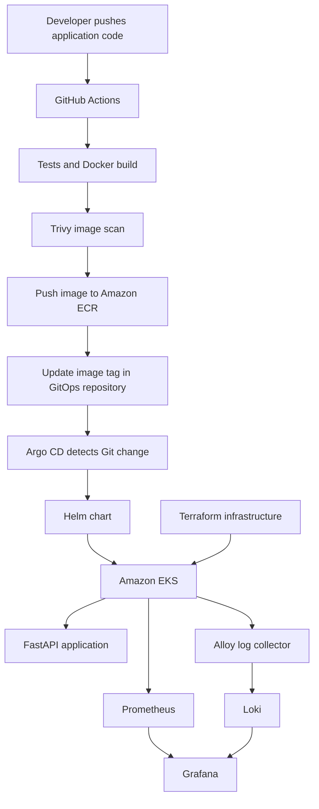

# Platform GitOps

This repository contains the desired Kubernetes deployment configuration for an AWS-based DevOps platform.

Argo CD monitors this repository and continuously reconciles the Kubernetes cluster with the configuration stored in Git.

## Technology Stack

### GitOps and Deployment
- GitHub
- Argo CD
- Kubernetes
- Helm
- Amazon EKS
- AWS Load Balancer Controller

### Monitoring and Logging
- Prometheus
- Grafana
- kube-prometheus-stack
- Loki
- Grafana Alloy
- Metrics Server

### Application
- FastAPI
- Docker
- Amazon ECR

## Architecture



## Repository Structure

```text
platform-gitops/
├── argocd/
│   ├── alloy.yaml
│   ├── aws-load-balancer-controller.yaml
│   ├── loki.yaml
│   ├── metrics-server.yaml
│   ├── monitoring.yaml
│   └── sample-application.yaml
│
└── charts/
    ├── alloy/
    ├── aws-load-balancer-controller/
    ├── loki/
    ├── metrics-server/
    ├── monitoring/
    └── sample-application/
```

## Argo CD Applications

Six Argo CD Applications manage the platform components:

| Application | Responsibility |
|---|---|
| sample-application | Deploys the FastAPI application |
| aws-load-balancer-controller | Integrates Kubernetes Ingress resources with AWS load balancers |
| metrics-server | Provides resource metrics for Kubernetes |
| monitoring | Deploys Prometheus, Grafana and related monitoring components |
| loki | Provides centralized log storage and querying |
| alloy | Collects Kubernetes pod logs and forwards them to Loki |

Each Application points to the corresponding configuration in this GitOps repository.

## Application Deployment

The FastAPI application is packaged as a Helm chart:

`charts/sample-application/`

The chart contains Kubernetes resources such as:

- Deployment
- Service
- Ingress

The Helm values file defines the application image repository, image tag, replica count and other deployment settings.

### Automated Image Updates

The application image tag is updated automatically by the GitHub Actions workflow in the application repository.

The process is:

1. A developer pushes application code to the main branch.
2. GitHub Actions runs tests and builds the Docker image.
3. Trivy scans the image.
4. GitHub Actions authenticates to AWS using OIDC.
5. The image is pushed to Amazon ECR with the Git commit SHA as its tag.
6. GitHub Actions updates `charts/sample-application/values.yaml` in this repository.
7. The updated values file is committed and pushed to GitHub.
8. Argo CD detects the Git change and synchronizes the application.
9. Kubernetes deploys the updated application image.

This provides traceability between application source commits, container image tags and deployed versions.

## Monitoring

The monitoring chart uses `kube-prometheus-stack`.

### Prometheus

Prometheus collects metrics from configured Kubernetes targets and application endpoints.

A CPU usage alert rule is configured with an 80% threshold.

### Grafana

Grafana provides dashboards and visualization for metrics and logs.

The Prometheus and Loki data sources are configured for querying monitoring data.

Grafana is exposed through the `/grafana/` path of the platform's load balancer endpoint.

## Centralized Logging

The logging pipeline uses Alloy and Loki.

1. Alloy collects Kubernetes pod logs.
2. Alloy forwards the logs to Loki.
3. Loki stores the logs.
4. Grafana queries Loki using LogQL.

Example LogQL query:

```logql
{namespace="monitoring"}
```

## Storage Configuration

| Component | Storage |
|---|---|
| Loki | 10 GiB persistent EBS-backed PVC |
| Prometheus | No persistent volume currently configured |
| Grafana | No persistent volume currently configured |

**Important:** Prometheus and Grafana data is currently ephemeral. Their stored data may be lost when their pods are recreated.

## AWS Load Balancer Integration

The AWS Load Balancer Controller manages AWS load balancer resources for Kubernetes Ingress configurations.

The infrastructure bootstrap script supplies the VPC ID from Terraform output to the controller's Argo CD Application configuration.

The sample application and Grafana are accessible through the provisioned load balancer.

## Operational Workflow

For application releases:

1. Change application source code in the application repository.
2. Push changes to GitHub.
3. GitHub Actions builds, tests and scans the image.
4. The image is pushed to Amazon ECR.
5. The GitOps image tag is updated automatically.
6. Argo CD synchronizes the updated configuration.
7. Verify the deployed application and its health.

For platform configuration changes:

1. Update the relevant Helm chart or Argo CD Application manifest.
2. Review and commit the change.
3. Push it to the GitOps repository.
4. Verify Argo CD synchronization and application health.

## Validation Status

The following platform applications were verified as Synced and Healthy in Argo CD:

- Alloy
- AWS Load Balancer Controller
- Loki
- Metrics Server
- Monitoring
- Sample Application

The application deployment was also validated end to end through GitHub Actions, Amazon ECR, GitOps and Argo CD.

A complete EKS destroy-and-recreate test remains outstanding.